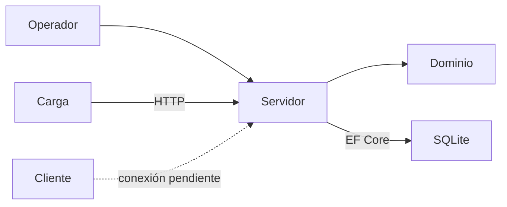
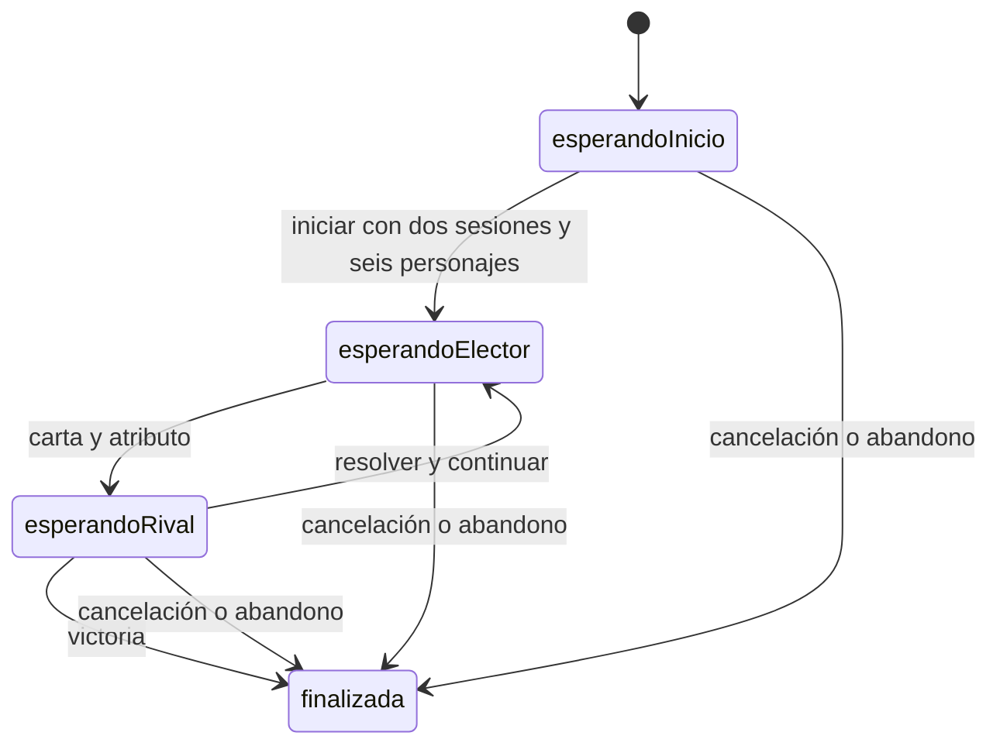

# Arquitectura

## Proyectos

- [Servidor](../src/servidor/README.md) aloja la API, aplica reglas y es dueño de SQLite.
- [Cliente](../src/cliente/README.md) presenta la interfaz de los jugadores y tiene una demostración local.
- [Carga](../src/subir-personajes/README.md) registra personajes por HTTP.
- [Pruebas](../test/proyecto-integrador-final-tests/README.md) verifican el dominio, el servidor y la consola.

El operador crea la partida en consola. Tras incorporar a ambos participantes, el servidor copia los personajes activos del catálogo al estado de la partida. Cada elección se valida contra la sesión, la revisión y la solicitud vigente. Con ambas cartas, el servidor compara los puntajes mediante el dominio y guarda el resultado y el recibo dentro de la misma escritura. La presentación devuelve la mano propia y los combates resueltos.

## Entrada interactiva

Los tres ejecutables solicitan sus datos por consola. El cliente ofrece la demostración y sus cinco variantes de cierre; los datos de conexión a una partida corresponden al cliente REST pendiente. El servidor pide dirección, archivo SQLite y credencial antes de construir el host, y solicita los identificadores después de elegir cada acción administrativa. La carga pide URL y credencial antes del personaje. Los valores inválidos pueden corregirse y el fin de entrada cancela la acción incompleta.

`src/comun/EntradaConsola.cs` se compila en los tres proyectos mediante un enlace de código fuente. Centraliza las preguntas, la validación de URL y la lectura oculta de credenciales en terminal interactiva. La entrada redirigida conserva el procesamiento por líneas para las pruebas. `ConfiguracionServidor` entrega los valores al host mediante la interfaz interna de `ServidorHttp.Crear`; las pruebas HTTP conservan su configuración aislada. El contrato HTTP no cambia. [Evidencia del spec 003](plan-de-pruebas.md#evidencia-del-spec-003)

## Estados de la partida

Cuando falta presencia durante una elección, el servidor informa la pausa sin cambiar la fase. Al recuperar la presencia se puede continuar desde la solicitud vigente.

[Modelos](modelos.md) · [API y operación](protocolo-de-partida.md) · [Bases de datos](bases-de-datos.md) · [Tecnologías](tecnologias.md) · [Instalación](instalacion-y-uso.md) · [UML académico](diagramas/uml.uxf)
