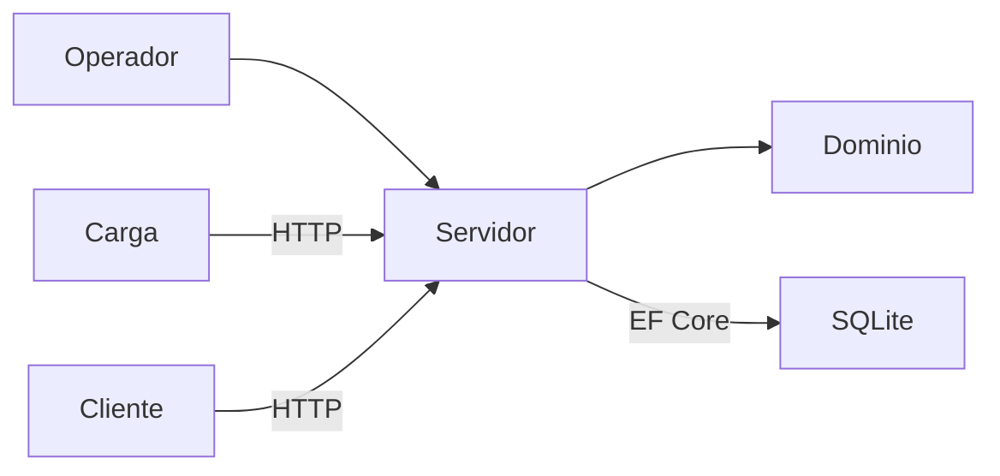
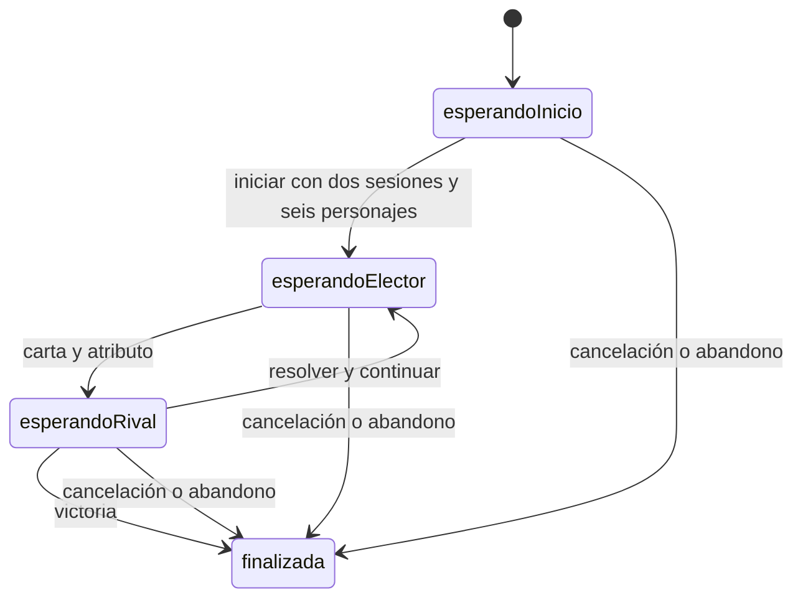

# Arquitectura

## Proyectos

- [Servidor](../src/servidor/README.md) aloja la API, aplica reglas y es dueño de SQLite.
- [Cliente](../src/cliente/README.md) presenta la interfaz de los jugadores y se comunica por HTTP con el servidor.
- [Carga](../src/subir-personajes/README.md) registra personajes por HTTP.
- [Pruebas](../test/proyecto-integrador-final-tests/README.md) verifican el dominio, el servidor y la consola.

El operador crea la partida en consola. Tras incorporar a ambos participantes, el servidor copia los personajes activos del catálogo al estado de la partida. Cada elección se valida contra la sesión, la revisión y la solicitud vigente. Con ambas cartas, el servidor compara los puntajes mediante el dominio y guarda el resultado y el recibo dentro de la misma escritura. La presentación devuelve la mano propia y los combates resueltos.

## Entrada interactiva

Los tres ejecutables solicitan sus datos por consola. El cliente pide URL, UUID de partida, credencial y nombre. El servidor pide dirección, archivo SQLite y credencial antes de construir el host, y solicita los identificadores después de elegir cada acción administrativa. La carga pide URL y credencial antes del personaje. Los valores inválidos pueden corregirse y el fin de entrada cancela la acción incompleta.

`src/comun/EntradaConsola.cs` se compila por enlace de código fuente. Servidor y carga lo usan para preguntas y credenciales. El cliente usa `ConfiguracionCliente` para preguntas cancelables y URL con prefijo de ruta. La entrada redirigida conserva el procesamiento por líneas para las pruebas. `ConfiguracionServidor` entrega los valores al host mediante la interfaz interna de `ServidorHttp.Crear`; las pruebas HTTP conservan su configuración aislada. El contrato HTTP no cambia. [Evidencia del spec 003](plan-de-pruebas.md#evidencia-del-spec-003)

## Coordinación del cliente

`ClientePartidaHttp` encapsula HttpClient y DTO propios, sin referencia al servidor. Usa cabeceras por petición, timeout de tres segundos y redirecciones deshabilitadas. `SesionPartidaCliente` es dueño del estado y del renderizado: coordina consultas cada segundo, presencia cada cinco segundos y una escritura a la vez. `EntradaCliente` entrega teclas o líneas cancelables. `EstadoCliente` valida y aplica presentaciones completas, incluida la pausa sin cambio de revisión.

La operación pendiente conserva UUID y cuerpo en memoria. Tras una respuesta perdida se consulta el recibo; solo se reenvía si una presentación válida confirma su vigencia. La reincorporación conserva el UUID de sesión del proceso. Las respuestas de una generación anterior se descartan. No hay persistencia del cliente.

La pantalla de lectura se separa de la presentación vigente. La primera vista establece una línea de base del historial; luego cada resultado nuevo se encola una vez por ronda y combate. El marcador de un resultado se reconstruye con el historial hasta ese punto. Enter avanza la lectura local; las consultas continúan mientras se lee o se navega por el menú.

## Estados de la partida

Cuando falta presencia durante una elección, el servidor informa la pausa sin cambiar la fase. Al recuperar la presencia se puede continuar desde la solicitud vigente.

[Modelos](modelos.md) · [API y operación](protocolo-de-partida.md) · [Bases de datos](bases-de-datos.md) · [Tecnologías](tecnologias.md) · [Instalación](instalacion-y-uso.md) · [UML académico](diagramas/uml.uxf)
