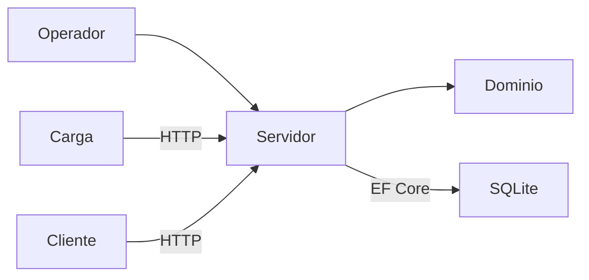
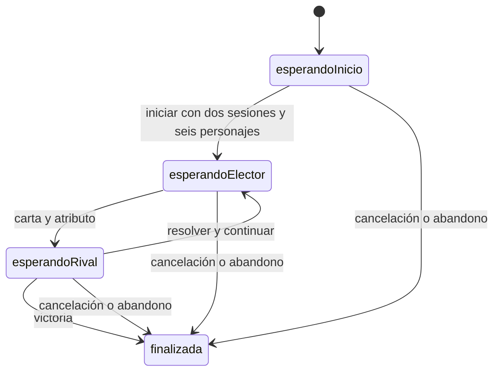
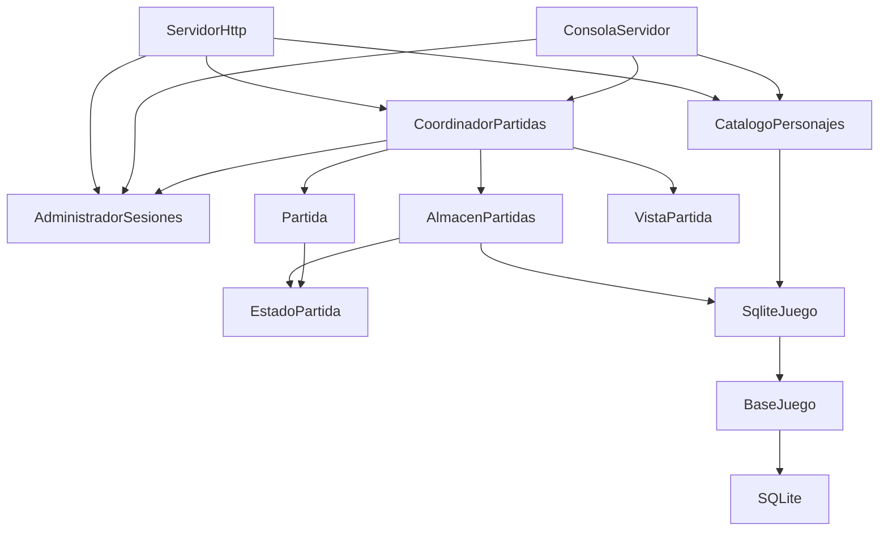

# Arquitectura

## Proyectos

- [Servidor](../src/servidor/README.md) aloja la API, aplica reglas y es dueño de SQLite.
- [Cliente](../src/cliente/README.md) presenta la interfaz de los jugadores y se comunica por HTTP con el servidor.
- [Carga](../src/subir-personajes/README.md) reemplaza el catálogo desde JSON por HTTP.
- [Pruebas](../test/proyecto-integrador-final-tests/README.md) verifican el dominio, el servidor y la consola.

El operador crea la partida en consola. Tras incorporar a ambos participantes, el servidor copia los personajes activos del catálogo al estado de la partida. Cada elección se valida contra la sesión, la revisión y la solicitud vigente. Con ambas cartas, el servidor compara los puntajes mediante el dominio y guarda el resultado y el recibo dentro de la misma escritura. La presentación devuelve la mano propia y los combates resueltos.

## Entrada interactiva

El cliente y el servidor solicitan su configuración por consola; la carga también admite la ruta JSON por argumento. El cliente pide URL, UUID de partida, credencial y nombre. El servidor pide dirección, archivo SQLite y credencial antes de construir el host, y solicita los identificadores después de elegir cada acción administrativa. La carga recibe una ruta JSON por argumento o pregunta, luego pide URL y credencial; consulta cantidades y requiere confirmación para reemplazar el catálogo. Los valores de conexión inválidos pueden corregirse; un error de archivo o carga finaliza sin reintento. El fin de entrada cancela la acción incompleta.

`src/comun/EntradaConsola.cs` se compila por enlace de código fuente. Servidor y carga lo usan para preguntas y credenciales. El cliente usa `ConfiguracionCliente` para preguntas cancelables y URL con prefijo de ruta. La entrada redirigida conserva el procesamiento por líneas para las pruebas. `ConfiguracionServidor` entrega los valores al host mediante la interfaz interna de `ServidorHttp.Crear`; las pruebas HTTP conservan su configuración aislada. El spec 005 agrega resumen y reemplazo del catálogo, conservando el POST individual. La herramienta de carga usa GET de resumen y PUT de reemplazo; no captura un personaje campo por campo. [Evidencia del spec 003](plan-de-pruebas.md#evidencia-del-spec-003)

## Coordinación del cliente

`ClientePartidaHttp` encapsula HttpClient y DTO propios, sin referencia al servidor. Usa cabeceras por petición, timeout de tres segundos y redirecciones deshabilitadas. `SesionPartidaCliente` es dueño del estado y del renderizado: coordina consultas cada segundo, presencia cada cinco segundos y una escritura a la vez. `EntradaCliente` entrega teclas o líneas cancelables. `EstadoCliente` valida y aplica presentaciones completas, incluida la pausa sin cambio de revisión.

La operación pendiente conserva UUID y cuerpo en memoria. Tras una respuesta perdida se consulta el recibo; solo se reenvía si una presentación válida confirma su vigencia. La reincorporación conserva el UUID de sesión del proceso. Las respuestas de una generación anterior se descartan. No hay persistencia del cliente.

La pantalla de lectura se separa de la presentación vigente. La primera vista establece una línea de base del historial; luego cada resultado nuevo se encola una vez por ronda y combate. El marcador de un resultado se reconstruye con el historial hasta ese punto. Enter avanza la lectura local; las consultas continúan mientras se lee o se navega por el menú.

## Estados de la partida

Cuando falta presencia durante una elección, el servidor informa la pausa sin cambiar la fase. Al recuperar la presencia se puede continuar desde la solicitud vigente.

[Modelos](modelos.md) · [API y operación](protocolo-de-partida.md) · [Bases de datos](bases-de-datos.md) · [Tecnologías](tecnologias.md) · [Instalación](instalacion-y-uso.md) · [UML académico](diagramas/uml.uxf)

## Responsabilidades del servidor

| Componente | Responsabilidad |
|---|---|
| `Partida` | Inicio, elección, combate, ronda y cierre por acciones sucesivas sobre `EstadoPartida`. Reutiliza `Combate`, `Ronda`, `Jugador` y `Mazo`; no conoce HTTP, EF Core ni SQLite. |
| `CoordinadorPartidas` | Acceso, presencia, recuperación de operaciones previas, invocación del dominio y confirmación del recibo. No calcula ganadores ni construye la vista. |
| `AlmacenPartidas` | Carga y mapeo explícito entre entidades SQLite y dominio; persistencia de estado y operaciones dentro de la transacción. |
| `AdministradorSesiones` | Incorporación, renovación, exclusión de plaza, vencimiento, cierre y rotación de credencial. La presencia permanece en memoria. |
| `CatalogoPersonajes` | Alta, validación, conteo, desactivación, reemplazo atómico y copia del catálogo activo al iniciar. |
| `VistaPartida` | Proyección de mano propia, solicitud de la plaza e historial resuelto; calcula pausa desde presencia sin modificar el dominio. |

`ServidorHttp` conserva rutas, cabeceras y respuestas. `ConsolaServidor` recibe por separado coordinador, sesiones y catálogo. `BaseJuego` mantiene el mapeo EF Core del esquema existente. `SqliteJuego` es infraestructura de conexión, transacción y sincronización compartida; `UnidadPartida` ofrece el dominio y las operaciones cargadas sin exponer DbContext al coordinador.

Una elección mantiene la coordinación compartida desde la autenticación y vigencia hasta la confirmación. La transacción adquiere el bloqueo SQLite antes de cargar el estado modificable. Un reintento idéntico recupera el recibo antes de validar el turno actual. Para una acción nueva, `Partida` valida revisión, solicitud y opciones y aplica las reglas. `AlmacenPartidas` guarda estado, solicitud consumida y recibo juntos. El cierre o cambio de credencial usa la misma coordinación; una rotación fallida no invalida anticipadamente la presencia.

La reconstrucción restaura el estado sin repartir ni repetir resultados. El catálogo iniciado se conserva como copia propia de la partida. La vista recibe un estado consistente y la presencia actual; oculta decisiones pendientes y no produce escrituras. Las clases `RepositorioJuego` y su archivo `TransicionesPartida` fueron retirados en el spec 006; `PresentacionPartida.cs` conserva los DTO públicos. La antigua entrada `Partida.Jugar()` fue sustituida por `Iniciar`, `RegistrarEleccion`, `Abandonar` y `Cancelar`; el flujo REST utiliza ahora ese mismo dominio.

[Partida](archivos/src/servidor/Partida.md) · [Coordinador](archivos/src/servidor/Api/CoordinadorPartidas.md) · [Catálogo completo](archivos/README.md) · [Verificación del spec 006](plan-de-pruebas.md#separación-de-responsabilidades-spec-006).
