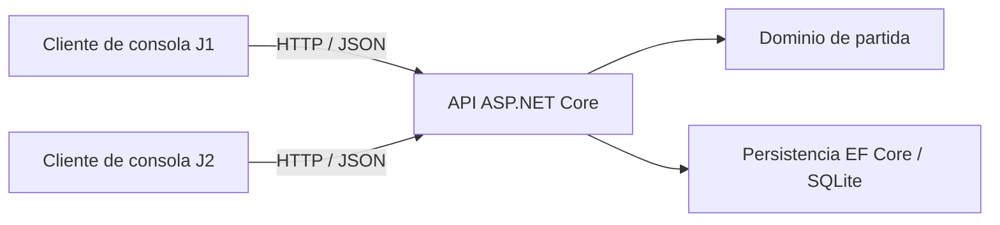
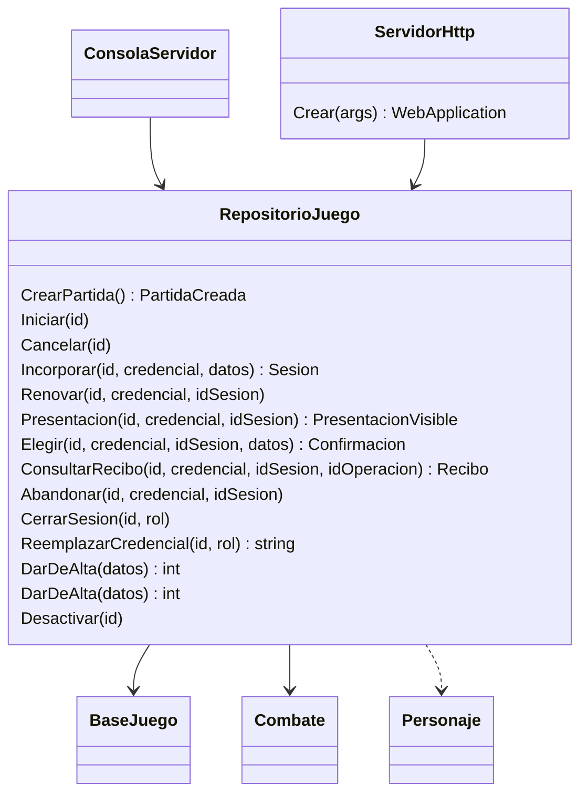

# Arquitectura

Diseño de TI basado en las [reglas del juego](../../reglas-del-juego.md) y el [diagrama UML](README.md). El [plan](../plan.md) reúne los entregables y pendientes.

- [Componentes HTTP](#comunicación-http--actividad-6)
- [Responsabilidades del dominio](#distribución-y-responsabilidades)
- [Contratos por clase](#especificación-de-clases-y-métodos--actividad-4)
- [Datos y validación de personajes](#datos-y-validación-de-personajes--actividad-5)
- [Presentación de consola](#presentación-de-consola)

## Proyectos de la solución

| Proyecto | Responsabilidad |
|---|---|
| `src/cliente` | Punto de entrada de consola. La interacción con la API está pendiente. |
| `src/servidor` | Dominio y reglas de la partida. Incluye la API HTTP, la consola del operador y la persistencia. |
| `src/subir-personajes` | Herramienta de consola para dar de alta personajes mediante la API del servidor. |

Las pruebas de dominio e integración HTTP viven en `test/` y referencian `servidor`.

### Alta de personajes desde consola

1. `subir-personajes` pide el nombre, la descripción y el arte ASCII. Pide los seis atributos, con valores entre 250 y 750 inclusive.
2. La herramienta envía los datos mediante el [alta individual de personajes](Protocolo-de-partida.md#alta-individual-de-personajes). El servidor valida el personaje según las reglas del dominio y guarda el alta en el catálogo cuando los datos son válidos.
3. Cuando el servidor confirma el alta, la consola pregunta «¿Deseás cargar otro personaje?». Si la respuesta es afirmativa, vuelve a pedir los datos. Si es negativa, termina.

## Comunicación HTTP — actividad 6

El usuario informó el 17 de noviembre de 2026 que se aprobó usar HTTP en la red local para la entrega. El [protocolo REST](Protocolo-de-partida.md) detalla el flujo y las operaciones HTTP. El [plan](../plan.md#actividad-6--comunicación-http-en-red-local) registra las decisiones y verificaciones pendientes.



Servidor y cliente J1 se ejecutan en el primer equipo Windows. El cliente J2 se ejecuta en el segundo. Cada cliente usa una dirección configurable y el puerto acordado es TCP 5000. El servidor inicia primero.

La API identifica al participante, valida el intercambio y prepara una presentación por jugador. El dominio mantiene la partida y aplica las reglas. El servidor confirma el estado y los recibos de las operaciones mediante persistencia local. SQLite también conserva el catálogo permanente. Los DTO delimitan los datos visibles en cada cliente. El protocolo especifica la identidad, la concurrencia y la recuperación. Las comprobaciones de conectividad están en el [procedimiento de verificación](Protocolo-de-partida.md#verificación-en-dos-equipos).

El [UML de dominio](README.md) documenta las clases de la actividad 4. El siguiente diagrama muestra los componentes del servidor en la rama de la API.



`ServidorHttp` registra las rutas y convierte las respuestas y errores al formato acordado. `RepositorioJuego` identifica a cada participante, proyecta su vista y aplica las transiciones del protocolo mediante `BaseJuego`. Para resolver un combate reconstruye las cartas y los participantes necesarios y delega la comparación a `Combate.Resolver`. El servidor usa los umbrales de `Ronda` y `Partida` y conserva la progresión en SQLite entre solicitudes. El estado y el recibo se confirman juntos en una transacción de escritura.

El catálogo persistido guarda el ID y la descripción, y usa el constructor de `Personaje` para validar los puntajes. Las operaciones de la consola y la protección del alta se detallan en el [protocolo](Protocolo-de-partida.md#operación-del-servidor).

## Distribución y responsabilidades

El servidor coordina la partida y analiza los enfrentamientos. Los clientes capturan elecciones y presentan los resultados a partir de vistas HTTP.

| Clase | Datos encapsulados | Responsabilidad y delegación |
|---|---|---|
| Personaje | Nombre, descripción, ASCII y seis atributos. | Representar una carta válida; ofrecer consultas y configurar su persistencia. No lee archivos directamente. |
| Mazo | Colección de personajes disponibles. | Mezclar, retirar elementos al repartir y reincorporarlos. Recibe objetos ya cargados. |
| Jugador | Nombre, mano disponible y rondas ganadas. | Administrar sus cartas y marcador. Las consultas devuelven una copia de la colección. |
| Partida | Dos jugadores, mazo, ronda actual y número de ronda. | Coordinar inicio, reparto, rondas, recuperación y victoria. Delega la comparación a Combate y el seguimiento de ronda a Ronda. |
| Ronda | Jugador mano, rival y combates registrados. | Determinar el siguiente elector y el ganador de ronda. Calcula las victorias desde los combates, evitando contadores duplicados. |
| Combate | Participantes, atributo, elecciones y ganador. | Registrar las elecciones y resolver la comparación. Los campos aún no elegidos y el ganador pendiente son anulables. |
| InterfazConsola | Sin estado de dominio propio obligatorio. | Componer las pantallas del juego y solicitar opciones. No determina ganadores. |

El jugador mano pertenece exclusivamente a Ronda y permanece fijo durante sus combates. Partida numera las rondas desde 1 y calcula los argumentos al construirlas: J1 es mano en las impares y J2 en las pares. No conserva otra referencia de jugador mano ni necesita un método para alternarla. Jugador tampoco conserva una copia de ese rol. Las entidades del juego se conservan porque representan conceptos propios del problema y permiten explicar sus reglas.

## Notación de atributos y relaciones

Las referencias a objetos y colecciones de entidades se representan exclusivamente mediante asociaciones, sin duplicarlas en el compartimento de atributos. Cada extremo navegable indica el nombre del rol, su multiplicidad y su visibilidad: `-` privado y `+` público. Por ejemplo, Ronda se relaciona con Jugador mediante los roles privados `- jugadorMano` y `- jugadorRival`, cada uno con multiplicidad 1.

Los roles diferentes se dibujan como asociaciones distintas, incluso si apuntan a la misma clase. El ganador de Combate tiene multiplicidad 0..1 mientras no se resuelva; sus dos cartas también tienen 0..1 durante la elección. Las dependencias de uso y la realización de interfaces no representan atributos y no llevan visibilidad de miembro. Los valores simples y enumeraciones permanecen en el compartimento de atributos.

### Convenciones de representación

Se consultó la [especificación UML 2.5.1 de OMG](https://www.omg.org/spec/UML/2.5.1/PDF): sección 9.4.4 para miembros estáticos y de solo lectura, 10.2.4 para enumeraciones y 11.5.4 para asociaciones. La [documentación de UMLet](https://www.umlet.com/faq.htm) define la representación mediante lt, r1/r2 y m1/m2 y la conexión de extremos a los bordes.

TipoAtributo utiliza la palabra clave «enumeration» y un literal por línea. Por convención solicitada por el usuario, cada literal lleva `+`. Los miembros estáticos se subrayan. Las asociaciones navegables usan línea continua y punta abierta.

Las firmas conservan nombres de tipos y colecciones de C# para orientar la futura implementación; no constituyen una especificación completa de plantillas UML. El atributo opcional TipoAtributo de Combate expresa multiplicidad `[0..1]`.

## Especificación de clases y métodos — actividad 4

Las firmas indican parámetros y retornos. Salvo donde se indica estático, los métodos son de instancia. Las condiciones que garantiza el flujo se describen como precondiciones, sin exigir que cada método vuelva a comprobarlas. Los datos externos se validan al recibirlos: las opciones en la entrada, las reglas numéricas al construir Personaje y la disponibilidad de la carta en Combate.SetCarta. Los controles de solicitudes HTTP están especificados en el protocolo web. Los errores técnicos de entrada o archivos llegan al punto de ejecución para informar y finalizar.

### Personaje

Representa una carta válida con ID, nombre, descripción, ASCII y seis atributos privados. No ofrece modificación pública de esos valores.

#### Constructor `Personaje(id: int, nombre: string, descripcion: string, ascii: string, fuerza: int, velocidad: int, resistencia: int, inteligencia: int, energia: int, habilidad: int)`

Es público y recibe el ID, el nombre, la descripción, el ASCII y los seis atributos. El ID es int, único y estable, proporcionado por el sistema externo; se conserva en el campo privado id sin setter. No se ha definido un rango numérico para este identificador. La descripción contiene el texto sobre la historia o las características del personaje y se conserva en el campo privado descripcion; es opcional, admite texto vacío y no tiene límite de longitud definido por el juego. La ausencia de descripción se representa mediante texto vacío (""), según la definición del usuario; se conserva el tipo string. No se utiliza null para representar esa ausencia. Comprueba que el nombre no sea nulo, vacío ni solo espacios y que el ASCII no sea nulo; si falta alguno, rechaza la construcción con ArgumentException. Guarda los datos y llama a Validar para comprobar las reglas numéricas. El ASCII se prepara con contenido, con un máximo de 25 líneas de 120 caracteres cada una y sin tabulaciones, conforme al formato de la actividad 5. Por indicación del usuario, no se agrega una validación de texto vacío; se conserva el rechazo de null ya especificado. Así, las demás clases pueden usar el personaje sin volver a validar sus datos.

#### `Validar(): void`

Es privado y comprueba que cada atributo esté entre 250 y 750, que los seis sumen 3000, que alguno sea mayor o igual a 650 y que alguno sea menor o igual a 350. Si no se cumple alguna condición, rechaza la construcción con ArgumentException e indica el motivo. No modifica los valores.

#### `GetId(): int`

Es público y devuelve el identificador almacenado, sin modificarlo. Se utiliza para relacionar el idPersonaje enviado en RespuestaDto con el catálogo; no depende del orden de sus filas.

#### `GetNombre(): string`

Es público y devuelve el nombre del personaje para identificarlo, sin modificarlo.

#### `GetDescripcion(): string`

Es público y devuelve la descripción almacenada del personaje, sin modificarla ni exponer una operación de escritura. No define cuándo debe presentarse en consola; esa decisión sigue pendiente.

#### `GetAscii(): string`

Es público y devuelve el ASCII del personaje para que InterfazConsola lo muestre.

#### `GetAtributo(tipo: TipoAtributo): int`

Es público y recibe un TipoAtributo elegido entre las seis opciones del juego. Devuelve el valor de ese atributo para permitir la comparación de cartas. La opción se valida al recibir la entrada; este método solo consulta el valor.

### Mazo

Administra una colección privada de personajes disponibles, su orden y sus transferencias; no controla marcadores ni compara atributos.

#### Constructor `Mazo(personajes: List<Personaje>)`

Es público y recibe los personajes cargados del catálogo. Copia la lista para que los cambios externos en ella no alteren el mazo. La carga del catálogo debe resolver datos faltantes o duplicados; el constructor no repite esas comprobaciones. La cantidad mínima para jugar se controla en Partida.Iniciar.

#### `Mezclar(): void`

Es público y cambia al azar el orden de las cartas disponibles, conservando las mismas cartas y su cantidad. Puede implementarse con Fisher–Yates. Se usa antes de repartir; con menos de dos cartas no necesita hacer cambios.

#### `Repartir(cantidad: int): Personaje[]`

Es público y recibe la cantidad de cartas que debe retirar. Devuelve esas cartas en un arreglo y las quita del comienzo del mazo. Partida lo llama con tres después de comprobar que hay suficientes cartas para ambos jugadores; el método no repite esa comprobación.

#### `Devolver(personajes: Personaje[]): void`

Es público y agrega al final del mazo las cartas recibidas. Partida reúne las cartas de la ronda y realiza una sola devolución al cerrarla. El método no necesita buscar duplicados porque el flujo de reparto y recogida conserva cada carta una sola vez.

#### `GetCantidad(): int`

Es público y devuelve la cantidad de cartas disponibles en el mazo, sin contar las que están en juego.

### Jugador

Conserva nombre, mano privada de hasta tres cartas y rondas ganadas. El rol de jugador mano pertenece a Ronda, no a Jugador.

#### Constructor `Jugador(nombre: string)`

Es público y recibe el nombre del jugador, comprobado al solicitarlo. Guarda el nombre, crea una mano vacía e inicia en cero el contador de rondas ganadas.

#### `RecibirCartas(personajes: Personaje[]): void`

Es público y agrega a la mano las cartas recibidas, conservando su orden. Partida entrega las tres cartas que obtuvo del mazo al comenzar la ronda, cuando la mano está vacía. Jugador mantiene su propia colección y no vuelve a comprobar el reparto.

#### `QuitarCarta(personaje: Personaje): void`

Es público y retira de la mano la carta indicada. Lo llama Combate.SetCarta después de comprobar que la carta está disponible, por lo que no repite esa validación. El coordinador no debe retirarla una segunda vez.

#### `EntregarCartas(): Personaje[]`

Es público y devuelve las cartas que quedan en la mano en un arreglo, dejando la mano vacía. Partida lo usa para recoger las cartas no jugadas; si no queda ninguna, devuelve un arreglo vacío.

#### `GetCartas(): Personaje[]`

Es público y devuelve una copia de la mano disponible para mostrar las cartas o comprobar una elección. Consultar la mano no retira cartas y modificar el arreglo devuelto no cambia la colección del jugador.

#### `SumarRondaGanada(): void`

Es público e incrementa en uno las rondas ganadas. Partida.JugarRonda lo llama una sola vez, después de obtener el ganador de la ronda.

#### `GetRondasGanadas(): int`

Es público y devuelve la cantidad de rondas ganadas, que comienza en cero. Permite mostrar el marcador y comprobar el final de la partida.

#### `GetNombre(): string`

Es público y devuelve el nombre del jugador para identificarlo en pantalla.

### Combate

Es una clase interna (`internal`) que representa un enfrentamiento entre dos jugadores. Conserva los participantes, el atributo elegido, las cartas seleccionadas y el ganador.

El atributo, las cartas y el ganador comienzan ausentes. No modifica el marcador de rondas.

#### Constructor `Combate(quienElige: Jugador, rival: Jugador)`

Es público y recibe al jugador que elige el atributo y a su rival, determinados por `Ronda`.

Guarda ambos participantes y deja pendientes el atributo, las cartas y el ganador.

Valida que ninguno de los participantes sea `null` y que ambos jugadores sean distintos. Si alguna condición no se cumple, lanza una excepción.

#### `SetAtributo(tipo: TipoAtributo): void`

Es público y guarda el atributo elegido para el combate.

Recibe una opción ya validada en la entrada. Comprueba que todavía no se haya registrado otro atributo y que el valor pertenezca al enum `TipoAtributo`.

Si alguna condición no se cumple, rechaza la operación sin modificar el estado.

Se llama una sola vez, antes de resolver el enfrentamiento. La coordinación del turno corresponde al flujo de la partida.

#### `SetCarta(jugador: Jugador, personaje: Personaje): void`

Es público y recibe al jugador y su carta elegida.

Coordina la validación y el registro de la carta mediante los siguientes pasos:

1. Comprueba que el jugador y el personaje no sean `null`.
2. Llama a `ValidarParticipante` para comprobar que el jugador participe en el combate.
3. Llama a `ValidarCartaDisponible` para comprobar que todavía no haya registrado una carta y que el personaje siga en su mano.
4. Llama a `QuitarCarta` para retirar el personaje de la mano.
5. Llama a `RegistrarCarta` para guardar la referencia correspondiente al jugador.

Si alguna validación falla, rechaza la elección sin modificar el estado ni retirar la carta.

Esta es la comprobación de la elección; `QuitarCarta` no repite las validaciones que ya realiza `Combate`. La recepción y validación de mensajes se definirán en la actividad 6.

## `EstaCompleto(): bool`

Es público y devuelve `true` cuando ya están registrados el atributo y las dos cartas. Mientras falte alguno, devuelve `false`.

Permite al coordinador saber cuándo puede resolver el combate.

#### `Resolver(): Jugador`

Es público y se llama cuando `EstaCompleto()` devuelve `true`.

Comprueba que el combate esté completo y que todavía no haya sido resuelto.

Compara el atributo elegido de ambas cartas: gana quien eligió solamente si su valor es mayor; en caso contrario gana el rival, incluido el empate.

Guarda y devuelve el ganador. No modifica el marcador de rondas.

Ejemplo ilustrativo del núcleo de comparación:

```csharp
int valorElector = cartaQueElige.GetAtributo(atributoElegido);
int valorRival = cartaRival.GetAtributo(atributoElegido);

ganador = valorElector > valorRival
    ? jugadorQueElige
    : jugadorRival;
```

## `GetGanador(): Jugador`

Es público y devuelve el ganador guardado por `Resolver()`.

Si el combate todavía no fue resuelto, lanza una excepción.

Se consulta después de resolver el combate, para contar las victorias o mostrar el resultado.

#### `GetAtributo(): TipoAtributo`

Es público y devuelve el atributo registrado.

Si todavía no se eligió un atributo, lanza una excepción.

`InterfazConsola` lo consulta al presentar el resultado completo del combate.

#### `GetCarta(jugador: Jugador): Personaje`

Es público y recibe uno de los participantes para devolver su carta registrada.

Comprueba que el jugador no sea `null` y que el combate esté completo. Si el jugador no participa, rechaza la consulta.

Se usa después de completar el combate, tanto para mostrar el resultado como para recuperar las cartas al cerrar la ronda.

No retira ni devuelve cartas por sí mismo.

#### `GetParticipantes(): Jugador[]`

Es público y devuelve un arreglo con los dos participantes, primero quien elige y después su rival.

Permite consultar sus nombres y cartas sin modificar los roles del combate.

#### `ValidarParticipante(jugador: Jugador): void`

Comprueba que el jugador recibido sea uno de los dos participantes del combate.

Utiliza la identidad de los objetos para comparar los participantes.

Si el jugador no pertenece al combate, lanza una excepción. No modifica el estado.

#### `ValidarCartaDisponible(jugador: Jugador, personaje: Personaje): void`

Comprueba que el jugador todavía no haya registrado una carta y que el personaje elegido siga en su mano.

Determina qué espacio de carta corresponde al jugador y verifica ambas condiciones.

Si alguna falla, rechaza la elección sin modificar el estado ni retirar la carta.

#### `RegistrarCarta(jugador: Jugador, personaje: Personaje): void`

Guarda la referencia del personaje en el espacio correspondiente al jugador.

Si el jugador es quien elige, guarda la carta en `cartaQueElige`. En caso contrario, la guarda en `cartaRival`.

No realiza validaciones porque estas ya fueron efectuadas por `SetCarta`.

### Ronda

Conserva jugador mano, rival y hasta tres combates registrados. Calcula victorias desde los resultados, sin contadores duplicados. El jugador mano permanece fijo durante la ronda.

#### Constructor `Ronda(mano: Jugador, rival: Jugador)`

Es público y recibe al jugador mano y a su rival, determinados por Partida según el número de ronda. Guarda esos roles y crea la colección vacía de combates.

#### `AgregarCombate(combate: Combate): void`

Es público y agrega al historial el combate que Partida acaba de resolver. Partida lo llama una sola vez por combate mientras la ronda siga abierta. La selección de participantes corresponde al coordinador y la disponibilidad de las cartas ya se comprobó en SetCarta; aquí solo se registra el resultado.

#### `EstaDefinida(): bool`

Es público y devuelve true cuando uno de los jugadores ganó dos de los combates registrados. Calcula las victorias a partir de sus ganadores. Permite cerrar la ronda después de dos combates si ganó el mismo jugador, o después del tercero si ganó uno cada uno.

#### `GetGanador(): Jugador`

Es público y devuelve al jugador que ganó dos combates. Partida lo consulta cuando EstaDefinida devuelve true y se encarga de sumar la ronda al marcador.

#### `GetQuienEligeProximo(): Jugador`

Es público y devuelve quién elige el atributo del siguiente combate: el jugador mano en el primero y tercero, y su rival en el segundo. Partida lo consulta mientras la ronda no está definida. El resultado de los combates no altera este orden.

#### `GetCombates(): Combate[]`

Es público y devuelve una copia de los combates registrados en orden de juego. Partida los consulta para reunir las cartas jugadas al cerrar la ronda.

### Partida

Coordina en el servidor a J1, J2, Mazo y la ronda actual. Conserva número de ronda y la constante privada estática de solo lectura RONDAS_PARA_GANAR = 15. Sus operaciones privadas organizan los pasos que ejecuta Jugar.

#### Constructor `Partida(j1: Jugador, j2: Jugador, mazo: Mazo)`

Es público y recibe los dos jugadores recién creados y el mazo cargado. Guarda esas referencias y deja pendiente la primera ronda. La preparación de los jugadores corresponde al inicio de la aplicación; el constructor no vuelve a revisar sus manos ni sus marcadores.

#### `Jugar(): Jugador`

Es público y devuelve al ganador de la partida. Se llama una vez: inicia la partida, juega una ronda y recoge sus cartas. Si algún jugador llegó a 15 rondas ganadas, devuelve ese ganador. Si no, aumenta el número de ronda, crea la siguiente con J1 como mano en las impares y J2 en las pares, reparte y continúa. Los errores se propagan al punto de ejecución para informar y finalizar. La comunicación con los clientes se completará en la actividad 6.

#### `Iniciar(): void`

Es privado y prepara la primera ronda. Comprueba que el mazo tenga al menos seis cartas; si no, informa «No se puede jugar porque no hay suficientes cartas» mediante InvalidOperationException. Si alcanza, fija el número de ronda en 1, crea la ronda con J1 como mano y llama a RepartirCartas. Esta comprobación se realiza al comenzar: cada cierre devuelve las seis cartas antes del siguiente reparto.

#### `RepartirCartas(): void`

Es privado y prepara las manos de una ronda nueva. Mezcla el mazo, retira tres cartas para cada jugador con Repartir y las entrega con RecibirCartas. Iniciar garantiza la cantidad inicial y RecogerCartas restituye las cartas entre rondas, de modo que no hace falta repetir esos controles.

#### `JugarRonda(): void`

Es privado y juega la ronda actual. Mientras no está definida, consulta quién elige, crea un Combate con ese jugador y su rival, registra el atributo y las cartas recibidas, espera a que EstaCompleto devuelva true, resuelve y agrega el combate a la ronda. Al terminar, obtiene el ganador y llama una vez a SumarRondaGanada. SetCarta ya retira las cartas de las manos. La espera y el intercambio con los clientes se definirán en la actividad 6.

#### `RecogerCartas(): void`

Es privado y se llama una vez al cerrar cada ronda, incluida la última. Reúne las dos cartas de cada combate y las que quedan en ambas manos mediante EntregarCartas; luego devuelve el conjunto al mazo. Siempre recupera seis cartas: cuatro jugadas y dos restantes si hubo dos combates, o seis jugadas si hubo tres. Las manos quedan vacías para el siguiente reparto.

#### `EstaTerminada(): bool`

Es privado y devuelve true si alguno de los jugadores alcanzó RONDAS_PARA_GANAR, cuyo valor es 15. Se consulta después de registrar el ganador de cada ronda.

#### `DeterminarGanadorPartida(): Jugador`

Es privado y devuelve al jugador que llegó a 15 rondas ganadas. Jugar lo llama después de que EstaTerminada devuelve true. Como cada ronda suma una victoria a un solo jugador y la partida termina al alcanzar el umbral, no es necesario volver a comprobar si ambos o ninguno ganaron.

### InterfazConsola

La [interfaz de consola](../../diseno-de-interfaz.md) compone las pantallas con datos que recibe del flujo cliente. Los métodos son de instancia. Las firmas de implementación en `src/cliente` adaptan las del UML a vistas de presentación locales. `CartaVisible` lleva el identificador, el nombre y los atributos de una carta propia. `JugadorVisible` contiene el nombre y las rondas ganadas. `CombateVisible` contiene las dos jugadas reveladas, el atributo comparado, el ganador confirmado, el marcador de combates y el próximo elector si corresponde. `MesaVisible` aporta la identidad local, la ronda, el combate y los marcadores de ambos jugadores. El flujo cliente prepara estas vistas a partir de los datos del protocolo. Puede identificar la plaza ganadora de un combate mediante `GanaJ1` cuando dos jugadores comparten nombre.

#### `MostrarMano(mano: IReadOnlyList<CartaVisible>): void`

Muestra las cartas disponibles y sus atributos. Usa fichas en paralelo cuando caben y pasa a bloques verticales según el ancho disponible. Si la mano está vacía, lo informa.

#### `PedirCarta(mano: IReadOnlyList<CartaVisible>): CartaVisible`

Copia la lista de opciones, marca la opción activa y devuelve la carta seleccionada con su identificador. El flujo debe proporcionar solo las cartas de la mano que permite la solicitud vigente. La elección conserva la mano y el flujo registra la jugada ante el servidor. Una lista vacía provoca `InvalidOperationException`.

#### `PedirAtributo(permitidos: IReadOnlyList<string>? = null, mesa: MesaVisible? = null): string`

Muestra los atributos permitidos por la solicitud y devuelve el nombre de la opción elegida. Si se omite la lista, ofrece los seis atributos de la consigna. Una lista explícitamente vacía provoca `InvalidOperationException`. Si se proporciona la mesa, la vista conserva el encabezado del combate. Los métodos de selección ignoran las teclas sin acción y señalan el fin de entrada mediante `EndOfStreamException`.

#### `MostrarMarcador(j1: JugadorVisible, j2: JugadorVisible, ronda: int): void`

Muestra la ronda en curso, los nombres de los jugadores y sus rondas ganadas.

#### `MostrarEsperando(mensaje: string): void`

Muestra el motivo conocido de la espera. Omite el mismo mensaje cuando se repite consecutivamente. El flujo cliente realiza las consultas al servidor.

#### `MostrarCombate(combate: CombateVisible): void`

Presenta los participantes, las cartas jugadas, el atributo, los valores comparados, el ganador, el marcador y el próximo elector si está informado. El servidor proporciona el resultado confirmado.

#### `MostrarGanadorRonda(ganador: JugadorVisible): void`

Anuncia el nombre del ganador de la ronda. El flujo puede acompañar el anuncio con el marcador acumulado.

#### `MostrarGanadorPartida(ganador: JugadorVisible): void`

Anuncia el nombre del ganador de la partida. El flujo presenta el marcador final y gestiona la salida.

#### `MostrarError(mensaje: string): void`

Presenta la etiqueta textual `ERROR` y la resalta si la terminal admite color. El punto de ejecución decide si corresponde cerrar.

#### `MostrarEstado(titulo: string, mensaje: string): void`

Compone un encabezado y un mensaje general. El flujo proporciona el título y el detalle según el estado conocido.

El constructor acepta una entrada, una salida y un ancho opcionales para probar la consola con flujos de texto. Por defecto usa la entrada de consola y renderiza con Spectre.Console.

#### Métodos de las pantallas acordadas

- `MostrarPreparacion(local, estado)`, `MostrarEsperaInicial(local, participantes, motivo)`, `MostrarInicioRonda(mesa, mano, cartas)` y `MostrarEsperaRival(mesa, rival, cartas)` componen los paneles de información.
- `PedirCarta(mesa, cartas, abre)` devuelve la carta elegida. La apertura y la respuesta comparten la mesa de fichas con los seis atributos de cada carta. El encabezado de respuesta conserva el marcador y la apertura anuncia la elección posterior de atributo.
- `MostrarEnvio(mesa, estado)` distingue `Enviando`, `Recibido` y `Pendiente`. `MostrarCombate(mesa, combate)` agrega el encabezado de ronda y combate al duelo.
- `MostrarCierreRonda(mesa, ganador, proximoMano)` presenta el ganador, el marcador y el próximo jugador mano cuando existe. `MostrarCierrePartida(local, ganador, j1, j2)` muestra el resultado en una planilla y presenta la instrucción de salida.
- `MostrarSuspension(mesa, motivo, confirmada)` muestra el último marcador confirmado. `MostrarInterrupcion(local, causa, efecto, confirmada)` distingue el cierre local del final confirmado de la partida.

### Enumeraciones

TipoAtributo contiene Fuerza, Velocidad, Resistencia, Inteligencia, Energia y Habilidad; TipoProceso contiene Servidor, ClienteJ1 y ClienteJ2. No declaran métodos en el UML. Las entradas se convierten a estas opciones después de validarlas; los métodos que las reciben no repiten ese control.

## Datos y persistencia

El diseño REST usa SQLite mediante EF Core para conservar los personajes y las partidas en el servidor. Los clientes reciben las vistas de la API.

El protocolo HTTP define el alta, el esquema, las copias para cada partida y las transacciones de elección. Las reglas de validación de atributos siguen en Personaje. Consultá [Tecnologías del protocolo REST](Tecnologias-REST.md) y [Persistencia, concurrencia y catálogo](Protocolo-de-partida.md#persistencia-concurrencia-y-catálogo).

## Datos y validación de personajes — actividad 5

La carga vigente se realiza manualmente con `subir-personajes`. Esta decisión sustituye la lectura de archivos de personajes indicada en la consigna original. La herramienta envía los datos mediante el [alta individual HTTP](Protocolo-de-partida.md#alta-individual-de-personajes).

El servidor asigna un ID positivo y estable. El nombre debe tener contenido y la descripción admite texto vacío. El arte ASCII admite hasta 25 líneas de 120 caracteres como máximo, sin tabulaciones. Los seis atributos son enteros entre 250 y 750 inclusive, suman 3000 y deben incluir al menos un valor igual o superior a 650 y otro igual o inferior a 350.

## Presentación de consola

La [especificación de interfaz](../../diseno-de-interfaz.md) describe las pantallas, sus maquetas y su composición con Spectre.Console. La validación de opciones de entrada pertenece al cliente. Las consultas, esperas y reintentos siguen el [protocolo HTTP](Protocolo-de-partida.md#estados-presencia-y-recuperación).
